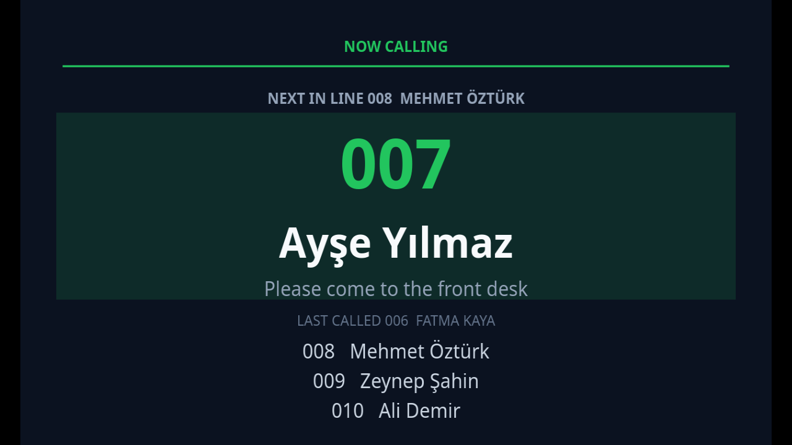
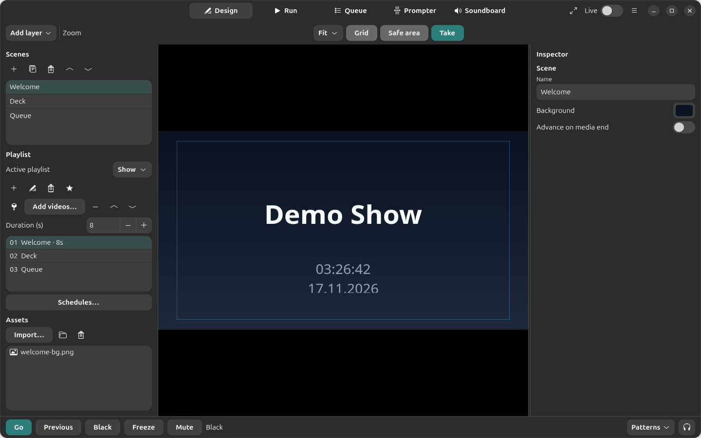
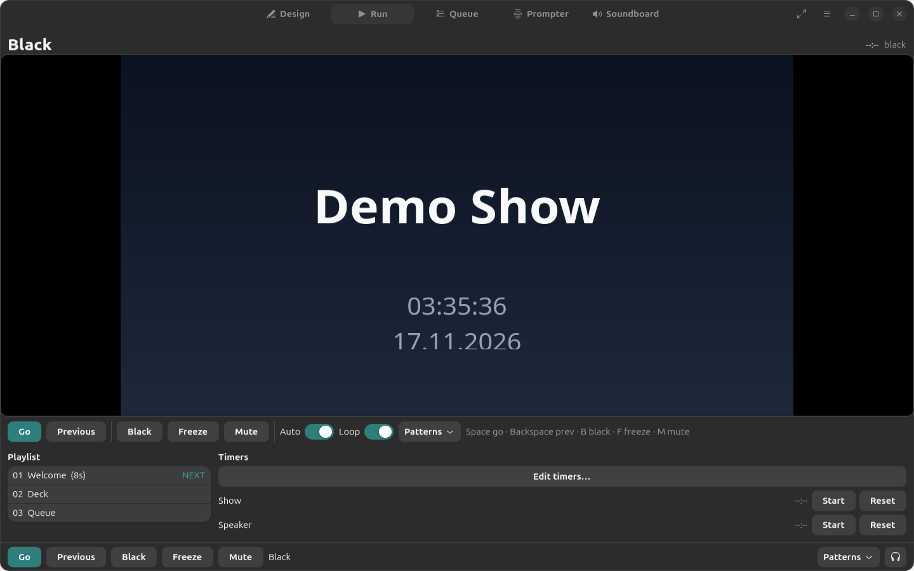
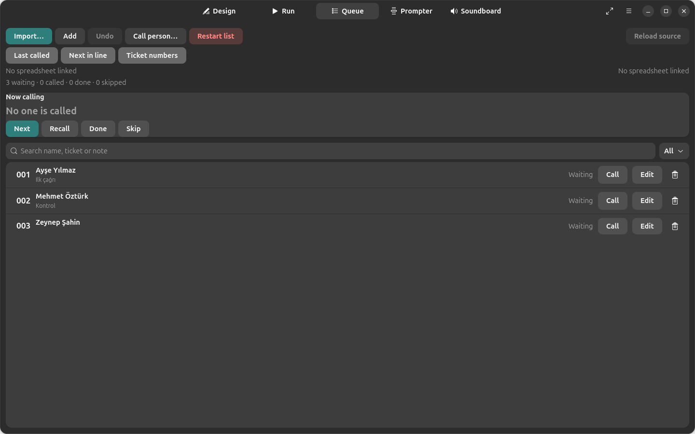
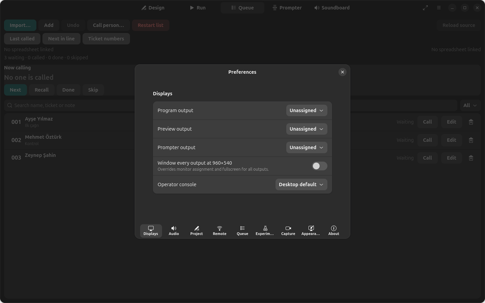
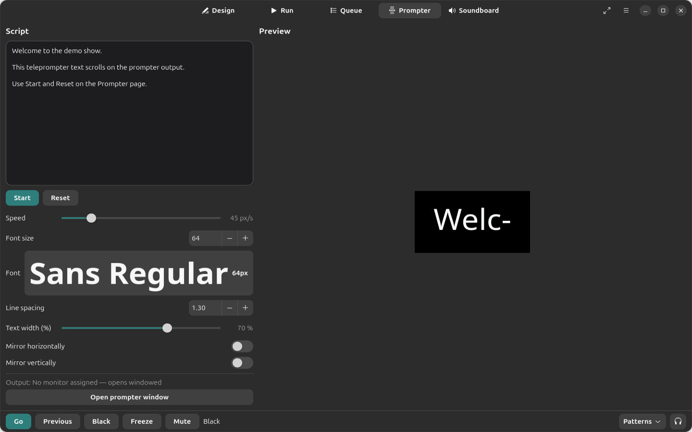
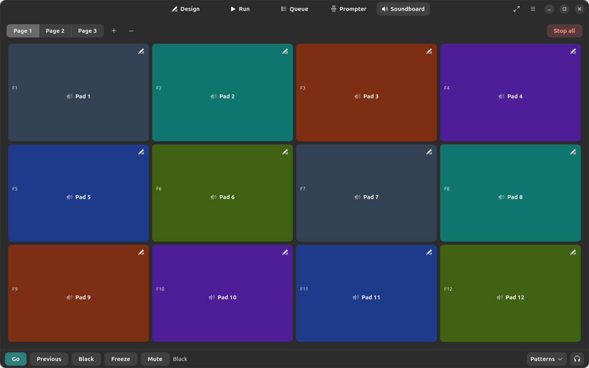
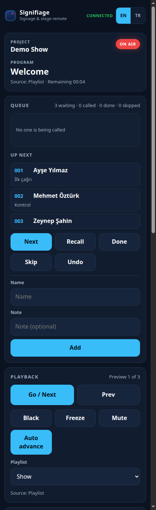

# Signifiage

**Signage, stage playback and queue console for Linux — one GTK4 application for what usually takes three.**

Signifiage designs signage and stage scenes, plays playlists of text, image, video and
capture sources on chosen monitors, keeps a called-name queue fed from spreadsheets,
runs a soundboard and a teleprompter, and can run standalone on a signage PC with a
phone-friendly web remote. English and Turkish, out of the box.




---

## Contents

- [What it does](#what-it-does)
- [Screenshots](#screenshots)
- [Install](#install)
- [Quick start](#quick-start)
- [Player, publish and the web remote](#player-publish-and-the-web-remote)
- [Capture and deck control](#capture-and-deck-control)
- [Queue workflow](#queue-workflow)
- [Keyboard shortcuts](#keyboard-shortcuts)
- [Where files live](#where-files-live)
- [Development](#development)
- [Limitations](#limitations)
- [License](#license)

---

## What it does

| Area | Highlights |
|---|---|
| **Design** | Scenes with 10 layer kinds — text, clock, timer, ETA, image, video, capture, queue, ticker, built-in patterns — on a fixed design canvas with grid, safe area, zoom, drag/resize handles, 50-step undo (design-only, so a scene undo never rolls back a live queue call). |
| **Show** | Program / preview / prompter outputs on chosen monitors, hard cuts with Go / Previous, editor “Take”, black, freeze (frame captured to a texture), mute, four test patterns with resume, and optional live edit of the on-air scene. |
| **Playlists** | Per-item durations, loop, player-default playlist, auto-advance suspended by Take/pattern/manual, media-EOS advance when a scene says so. |
| **Queue** | Import `.xlsx` / `.xls` / `.ods` with a mapping wizard, 2 s additive sync (statuses always preserved), Next/Recall/Done/Skip with undo, last-called and next-in-line switches, privacy mode, ticket toggle, breathing glow plus a chime when someone is called, call-a-person picker, restart-from-the-top, and experimental random pick with optional `.ods` write-back. |
| **Soundboard** | Three pages × 12 pads, F1–F12 hotkeys, per-pad colour/volume/loop, master mute, dock and page share one engine. |
| **Teleprompter** | Scroll speed, font, line spacing, width, mirror H/V, dedicated output whose aspect ratio the page preview matches. |
| **Player** | `signifiage player` plays a project or a packaged `.signifiage` file fullscreen on a signage PC, honours schedules every 30 s, and keeps queue progress in a player-scoped state file. |
| **Web remote** | Token-authenticated LAN dashboard: queue, transport, timers, prompter, soundboard, patterns, deck and uploads (uploads only while the GUI is running). |
| **Capture** | v4l2 cameras, X11 windows (`ximagesrc`), Wayland screens through xdg-desktop-portal, with a muted test window. |
| **Deck control** | Next/previous key injection for Slides/Canva/Impress via XTest or the RemoteDesktop portal. |
| **i18n** | 607 localised keys, English + Turkish, web dashboard included. |

## Screenshots

| Design | Run |
|---|---|
|  |  |

| Queue | Preferences |
|---|---|
|  |  |

| Prompter | Soundboard |
|---|---|
|  |  |

| Web remote (phone) |
|---|
|  |

## Install

Requirements: GTK 4.18+, libadwaita 1.6+, GStreamer 1.22+ with `gstreamer1.0-gtk4`,
`plugins-base/good/bad`, `gstreamer1.0-libav` (H.264/AAC), and `gstreamer1.0-pipewire`
for portal capture. `xdg-desktop-portal` + a backend is needed for screen capture and
key injection on Wayland.

```bash
# Prebuilt package (pulls gstreamer1.0-libav and friends automatically)
sudo apt install ./signifiage_0.1.0_amd64.deb

# or build it yourself
git clone https://github.com/ta4anx/signifiage.git
cd signifiage
bash scripts/bootstrap_dev.sh     # one-time: dev headers + rustup
bash scripts/build_deb.sh         # build/signifiage_<version>_amd64.deb (+ .sha256)
sudo apt install ./build/signifiage_0.1.0_amd64.deb
```

The package installs `/usr/bin/signifiage`, the desktop entry, the scalable icon, the
AppStream metainfo and the docs. Removing it leaves your projects alone — they are
plain directories you choose.

## Quick start

```bash
signifiage                          # last project, or the welcome page
signifiage ~/Shows/Stage2026        # open a project directory
```

1. **New Project** → pick a template (Stage show, Signage loop, Queue board, Blank).
2. **Design**: add layers, drag them on the canvas, edit properties in the right panel.
3. **Run**: **Go** commits the preview item to the program output; the editor’s
   **Take** puts the open scene straight on air.
4. **Queue**: import your spreadsheet, then drive it with Next / Recall / Done / Skip.

## Player, publish and the web remote

```bash
signifiage publish ~/Shows/Stage2026 ~/out/Stage2026.signifiage
signifiage player ~/out/Stage2026.signifiage --windowed --remote --port 8720
```

- `publish` writes a ZIP with `project.json` + `assets/` (atomic replace).
- The player extracts packages to a temp directory, plays the default playlist (or the
  schedule matching the local weekday/time, re-evaluated every 30 s), and never writes
  the package.
- Queue progress for the player lives in
  `${XDG_STATE_HOME:-~/.local/state}/signifiage/player-<key>.json` (0600, debounced), so
  a restart keeps the called name.
- `--remote` prints the URL and token. Open `http://<lan-ip>:8720/?token=<token>` once;
  the token is stored in the browser. Plain HTTP on the LAN — trusted networks only.
- Remote uploads land in the open project’s `assets/` and are rejected in player mode.

## Capture and deck control

| Source | Pipeline | Notes |
|---|---|---|
| Camera | `v4l2src` | Works on Wayland and X11; optional width/height/fps. |
| X11 window | `ximagesrc` | Window list read from `$DISPLAY` (X11 or XWayland). |
| Screen | `pipewiresrc` via portal | Needs an interactive approval; restore tokens are stored. |

Deck control sends Next/Previous to the focused presentation app: XTest on X11 (with
focus set to the captured window) or the RemoteDesktop portal on Wayland. Wayland cannot
change focus, so desktop deck buttons wait 2 s (“focus the presentation now”) while the
web remote sends the key immediately to whatever is focused.

## Queue workflow

- **Import** `.xlsx/.xls/.ods`: choose sheet, header row and Name/Ticket/Note/Status
  columns (auto-guessed). Imports are additive: existing rows refresh name/note only,
  statuses and call counts are never overwritten.
- **Live sync**: the source file is polled every 2 s (mtime+size); edits appear without
  touching the called state.
- **Calling**: Next promotes the first waiting row, Recall re-announces the current one,
  Done/Skip finish it. At most one row is *called*, and it is the board’s current entry.
- **Board switches** (also in the layer inspector): last-called (tracking), next-in-line
  (privacy — hides waiting names), ticket numbers.
- **Call feedback**: a bundled ding-dong (or your own file, Preferences → Queue) plus a
  breathing glow whose duration is configurable (0 disables it).
- **Call person…** picks anyone waiting by name; **Restart list** puts everyone back to
  waiting and restarts numbering (undoable).
- **Experimental** (Preferences → Experimental, off by default): *Random pick* adds a
  button that calls a random waiting person; *Write back* stores the called status in the
  linked `.ods` file.

## Keyboard shortcuts

Unless a text field has focus:

| Keys | Action |
|---|---|
| `Space` / `Backspace` | Go / Previous |
| `B` · `F` · `M` | Black · Freeze · Mute |
| `F11` or `Ctrl+F` | Fullscreen toggle |
| `S` | Soundboard dock |
| `F1`–`F12` | Soundboard pads (active page) |
| `Ctrl+S` · `Ctrl+Z` · `Ctrl+Shift+Z` | Save · Undo · Redo |
| `Ctrl+N` · `Ctrl+O` · `Ctrl+P` | New · Open · Publish |
| `Delete` · `Ctrl+D` | Delete layer · Duplicate layer |
| `Esc` | Leave fullscreen / close dock |

Canvas: drag to move, corner handles to resize, arrows nudge 1 px (`Shift` 10),
`Shift` while dragging disables grid snapping.

## Where files live

| Path | Contents |
|---|---|
| `<project>/project.json` | Document (atomic save, `.bak` fallback) |
| `<project>/assets/` | Images, video, audio, referenced by relative path |
| `~/.config/signifiage/config.json` | Monitors, audio sink, remote, language, theme, call sound, experiments (0600) |
| `~/.local/state/signifiage/log.txt` | Log (rotated at 5 MiB) |
| `~/.local/state/signifiage/player-*.json` | Player queue state |

## Development

```bash
cargo test --locked                 # 239 tests: model, queue, spreadsheet, timers,
                                    # schedule, controller, capture, deck, x11,
                                    # server, packages, ODS write-back
cargo fmt && cargo clippy --all-targets
```

Offscreen and structural proofs (also used for the screenshots above):

```bash
cargo run --release --example render_scene -- --project tests/fixtures/demo-project \
    --scene Queue --queue-demo --out /tmp/queue-board.png
cargo run --release --example gui_shot -- --project tests/fixtures/demo-project --page run --out /tmp/run.png
cargo run --release --example gui_shot -- --project tests/fixtures/demo-project --page design --settings --out /tmp/settings.png
cargo run --release --example dialog_smoke -- tests/fixtures/demo-project
cargo run --release --example interaction_smoke -- tests/fixtures/demo-project
cargo run --release --example x11_click -- 700 40          # one XTest click
```

- `render_scene` renders one scene (optionally with sample queue data) to a PNG.
- `gui_shot` renders a whole window page to a PNG.
- `dialog_smoke` constructs the New Project, Timers, Schedules and About dialogs.
- `interaction_smoke` checks what screenshots cannot: tab hit-testing, page switching,
  every window menu action, a page button handler, and that handlers survive the caller
  dropping the window handle.
- Verification harnesses keep their own XDG config/state directories.

Layout: `src/model` (document, serde, validation, packages) · `src/services`
(controller, queue, timers, spreadsheet, media, soundboard, capture, portal, deck, x11,
chime, remote bridge) · `src/ui` (pages, renderer, outputs, dialogs) · `src/server`
(axum + SSE + uploads) · `web` (remote dashboard) · `locales` · `data` (icon, desktop,
metainfo, chime, CSS).

## Limitations

- Single instance per project by design: a signage PC runs `signifiage player`, phones
  drive it through the web remote; there is no multi-player queue sync service.
- Screens are assigned with `fullscreen_on_monitor`; GTK4 cannot move the operator
  window between monitors on Wayland, so “operator console” means fullscreen-on-monitor.
- Portal capture and RemoteDesktop key injection need an interactive approval; cameras
  and X11 windows do not.
- H.264/AAC playback needs `gstreamer1.0-libav`; a missing decoder only affects that
  asset and shows a placeholder.
- No scene transitions, NDI, recording, per-layer rotation or subtitle editor — hard
  cuts and fixed layer sets are intentional.

## License

GPL-3.0-or-later. See [LICENSE](LICENSE). `data/queue_chime.wav` is generated for this
project and shipped under the same license.
